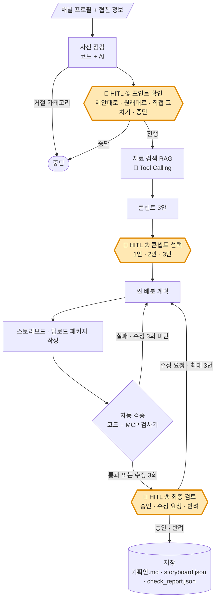
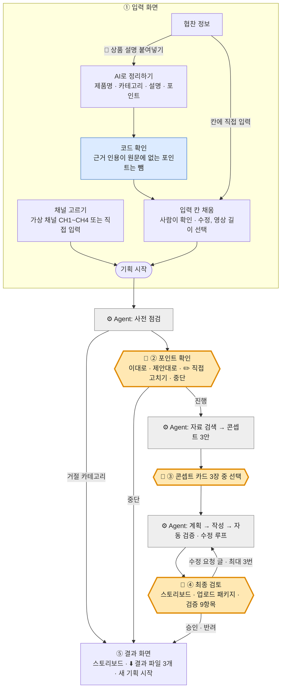

# 협찬 숏폼 기획 Agent

협찬을 받은 인플루언서가 **채널 프로필**과 **협찬 정보**를 넣으면, 60초 이하 숏폼(9:16)의 기획안·스토리보드·체크 리포트·업로드 패키지를 만들어 주는 AI Agent입니다.
**채널 톤 유지**, **광고주 포인트 반영**, **광고 규정 준수**를 같은 비중으로 지킵니다.

> AX 교육 미니프로젝트. 기획 원문은 [service.md](service.md), 작업 목록은 [TASKS.md](TASKS.md), 결정 기록은 [docs/decisions.md](docs/decisions.md)에 있습니다.

## 결과 요약

20세트 × (Agent, 기준선)으로 평가했습니다. 기준선은 **같은 생성 모델(Claude Haiku 4.5)에 같은 입력**을 주고, 프롬프트 한 번으로 같은 형식의 결과를 뽑게 한 것입니다. 그래서 두 쪽의 점수 차이는 Agent의 **구조**(사전 점검 · RAG · 계획 · 코드 보정 · 검증·수정 루프)에서 나온 것입니다.

| | Agent | 기준선 |
|---|---|---|
| **전체** | **0.946** | 0.784 |
| A 채널 톤 | 0.938 | 0.938 |
| B 포인트 반영 | 1.000 | 1.000 |
| C 규정·구성 | **0.950** | 0.660 |
| T1 함정 탐지 | **0.857** | 0.143 |

성공 기준(Agent ≥ 0.9이고 기준선보다 높음): **달성**.
채점은 한 단계 위 모델인 Claude Sonnet 4.6(temperature 0)으로 했습니다.

- 케이스별 점수와, 케이스마다 생성·채점에 쓴 모델: [docs/results/eval_summary.md](docs/results/eval_summary.md)
- 같은 제품 × 다른 채널 비교표(훅 · 첫 대사 · 제목): [docs/results/channel_compare.md](docs/results/channel_compare.md)
- 실행 결과 예시(자취 채널 × 보풀 제거기 30초, 최종 검토에서 수정 요청 1회 반영): [docs/sample_output/기획안.md](docs/sample_output/기획안.md) · [storyboard.json](docs/sample_output/storyboard.json) · [check_report.json](docs/sample_output/check_report.json)

## 어떻게 동작하나



🟧 주황 육각형이 사람이 개입하는 곳(HITL)입니다. 그래프가 `interrupt`로 멈추고, 사람이 답해야 다음으로 넘어갑니다. "직접 고치기"는 웹 화면에서만 나옵니다.

| 단계 | 하는 일 | 사용 기술 |
|---|---|---|
| 사전 점검 | 거절 카테고리 · 포인트 개수 초과 · 금지 표현은 코드로, 길이·비율 초과 · 모순 · 콘셉트 충돌은 AI로 찾고 조정안을 냅니다 | Pydantic 구조화 출력 |
| 사용자 확인 (3곳) | 사전 점검 조정안(웹 화면에서는 포인트를 직접 고칠 수도 있음), 콘셉트 선택, **최종 검토**(스토리보드·업로드 패키지를 보고 승인 · 수정 요청 · 반려. 수정 요청은 글로 적으면 계획부터 다시 만들어 자동 검증 후 다시 보여 줌, 최대 3회) | LangGraph `interrupt` |
| RAG | 금지 표현 · 훅 노하우 · 톤 유지법 문서를 검색합니다. 검색어는 모델이 정합니다 | Chroma(로컬 임베딩) + 키워드 혼합 검색, Tool Calling, `create_agent` |
| 계획 · 생성 | 씬별 초·제품 노출을 계획하고, 코드가 첫 씬 3초 이하 · 노출 30% 이하 · 길이 합을 보정합니다 | |
| 자동 검증 | 말투 · 시그니처 · 포인트 · 광고 표시 · 금지 표현 · 노출 비율 · 첫 씬 · 길이를 **코드로** 판정하고, 실패하면 이유를 붙여 다시 만듭니다(최대 3회) | 광고 표시 · 금지 표현은 자체 **MCP 서버**(광고 규정 검사기) |
| 안전장치 | 일시 오류 재시도, 실행당 호출 횟수 상한, 금지 표현 가드 | 미들웨어 |
| 실행 기록 | LangSmith 키가 있으면 LangSmith로, 없으면 `logs/`에 로컬 기록 | Trace |

규정(금지 표현, 광고 표시, 길이별 포인트 수, 노출 비율)은 [knowledge/rules.json](knowledge/rules.json) 한 곳에 모여 있습니다.

## 설치

필요한 것: Python 3.11 이상, AWS Bedrock 접속 키

```bash
pip install -r requirements.txt
cp .env.example .env
```

`.env`를 열어 아래 값을 채웁니다.

```
AWS_ACCESS_KEY_ID=...
AWS_SECRET_ACCESS_KEY=...
BEDROCK_REGION=us-east-1
# 선택: LANGSMITH_API_KEY=...   (없으면 logs/ 폴더에 기록)
```

모델은 [app/config.py](app/config.py)에서 정합니다.
- 생성: Claude Haiku 4.5. 실패하면 Nova 2 Lite로 넘어갑니다.
- 채점: Claude Sonnet 4.6. 실패하면 Sonnet 4.5로 넘어갑니다.
- us-east-1이 한도에 걸리면 같은 모델을 us-west-2에서 호출합니다.

## 실행

```bash
# 기획 만들기 (질문에 직접 답하는 대화형)
python -m app.main examples/normal.json

# 질문에 자동으로 기본값을 답하며 끝까지 실행
python -m app.main examples/normal.json --auto

# 다른 예시: 포인트가 너무 많은 경우 / 거절되는 카테고리
python -m app.main examples/trap_overflow.json
python -m app.main examples/rejected.json
```

결과는 `outputs/{시각}_{제품명}/`에 저장됩니다.
- `기획안.md`: 기획안 요약 · 스토리보드 표 · 체크 리포트 · 업로드 패키지
- `storyboard.json`: 스타일 시트 · 씬별 데이터 · 영문 이미지 프롬프트
- `check_report.json`: 항목별 통과 여부와 근거

입력 파일 형식은 [examples/normal.json](examples/normal.json)을 참고하세요. 채널 프로필은 `eval/channels/CH1~CH4.json`에 있는 가상 채널 4개입니다.

## 웹 화면

터미널 대신 브라우저에서 입력하고, 질문 3곳에 버튼으로 답할 수 있습니다. Agent 본체(그래프·노드·검증)는 터미널 실행과 똑같습니다.

```bash
python -m streamlit run app/web.py
```

- 처음 실행할 때 터미널에 `Email:`이 나오면 **Enter**만 누르세요.
- 브라우저가 자동으로 열리지 않으면 `http://localhost:8501`로 들어가세요.
- 쓰는 동안 터미널 창을 닫지 마세요. 끝낼 때는 그 창에서 `Ctrl + C`를 누릅니다.
- 이미 켜져 있는데 한 번 더 실행하면 `8502` 같은 다른 번호로 하나가 더 켜집니다. 하나만 켜 두세요.

화면 흐름:



🟧 주황 육각형은 사람이 답하는 화면, 🟦 파란 상자는 AI 결과를 코드가 확인하는 곳, ⬜ 회색 상자는 Agent가 일하는 동안(단계별 ✅ 표시)입니다. 버튼을 누르면 그 답이 멈춰 있던 그래프에 전달되고(`Command(resume=...)`), Agent가 다음 질문이나 끝까지 이어서 실행합니다.

웹 화면에만 있는 기능:

| 기능 | 하는 일 | 지키는 장치 |
|---|---|---|
| 채널 직접 입력 | 가상 채널 4개 외에 내 채널 정보를 화면에서 바로 입력 | 빈 칸이 있으면 시작 버튼이 눌리지 않음 |
| 상품 설명 붙여넣기 | 쇼핑몰 상세페이지 글을 붙여 넣으면 AI가 제품명·카테고리·제품 설명·추천 포인트를 채움 | 포인트마다 원문 근거 문장을 인용하게 하고, 그 문장이 붙여 넣은 글에 실제로 있는지 **코드로 확인**해 없는 포인트는 뺌. 카테고리가 목록에 없으면 비워 둠 |
| 포인트 확인 · 직접 고치기 | 사전 점검 뒤 영상에 넣을 포인트와 설명란 포인트를 **항상** 보여 주고, 사람이 문장을 고치거나 영상 ↔ 설명란으로 옮길 수 있음 | 영상 포인트가 길이별 상한을 넘으면 뒤쪽을 설명란으로 옮김(코드). 금지 표현은 미리 경고 |

> 붙여넣기는 글만 읽습니다. 상세페이지가 이미지로만 되어 있으면 이미지 속 글자는 읽지 못합니다.
> 쇼핑몰 링크로 자동으로 가져오는 기능은 없습니다. 쿠팡은 프로그램 접근을 막고(403) 약관에서도 자동 수집을 금지합니다.

### 사용자 시나리오 — 처음 써 보기 (약 5분)

자취 살림 채널(가상 채널 CH1 "오늘도 자취중")을 운영하는 인플루언서가 **미니 가습기** 협찬을 받았다고 해 봅니다. 아래 상품 설명은 연습용 가상 제품입니다.

**1. 화면 열기**
`python -m streamlit run app/web.py`를 실행하고 브라우저에서 `http://localhost:8501`을 엽니다.

**2. 채널 고르기 (왼쪽 ① 내 채널)**
`CH1 · 오늘도 자취중`을 고르고, "프로필 보기"를 펼쳐 말투(반말), 오프닝 멘트, 대표 포맷을 확인합니다.

**3. 상품 설명 붙여넣기 (오른쪽 ② 이번 협찬)**
"🛒 쇼핑몰 상품 설명을 붙여 넣어 자동으로 채우기"를 펼치고 아래 글을 붙여 넣은 뒤 **AI로 정리하기**를 누릅니다.

```
[로켓배송] 맑음 미니 가습기 MH-200 무드등 겸용 300ml
판매가 23,900원 (32% 할인)
★ 업계 1위 판매량! 최고의 초음파 가습기 ★
- 300ml 물통으로 최대 8시간 연속 가습
- 7가지 색상 LED 무드등, 버튼 하나로 켜고 끄기
- 소음 25dB 이하 저소음 설계로 잠잘 때도 조용해요
- USB-C 전원, 노트북·보조배터리로도 사용 가능
- 물통 입구가 넓어 손을 넣어 세척 가능
구성: 본체, 필터 2개, USB-C 케이블 / 무게 210g
배송 안내: 오후 2시 이전 주문 시 당일 출고. 교환·반품은 7일 이내.
리뷰 작성 시 포인트 500원 적립!
```

몇 초 뒤 제품 이름, 카테고리(전자·액세서리), 판매가가 들어간 제품 설명, 홍보 포인트가 채워집니다.
- 포인트마다 **원문 근거**가 함께 보입니다. 배송 안내와 리뷰 적립 이벤트는 포인트에서 빠집니다.
- "업계 1위"가 포인트에 들어가면 **금지 표현 안내**가 뜹니다. 그대로 두어도 다음 단계에서 고쳐 쓰자고 제안합니다.
- 광고주가 따로 요청한 포인트가 있다면 여기서 고칩니다.

**4. 영상 길이를 고르고 시작**
영상 길이 `30`초를 고르고 **기획 시작**을 누릅니다. 단계가 하나씩 "✅ … 완료"로 표시됩니다.

**5. 포인트 확인 (사람 확인 ①)**
영상에 넣을 포인트(30초는 최대 3개)와 설명란으로 보낼 포인트가 나뉘어 보입니다.
- 그대로 좋으면 **이대로 진행**(문제가 있었다면 **제안대로**)을 누릅니다.
- 바꾸고 싶으면 **✏️ 직접 고치기**를 펼칩니다. 예를 들어 영상 칸 맨 위에 `23,900원으로 자취방 겨울 필수템`을 추가하고 **고친 대로 진행**을 누릅니다. 상한을 넘으면 뒤쪽 포인트가 설명란으로 옮겨지고, 다음 화면에서 그 사실을 알려 줍니다.

**6. 콘셉트 고르기 (사람 확인 ②)**
훅이 서로 다른 콘셉트 카드 3장 중 하나를 고릅니다.

**7. 최종 검토 (사람 확인 ③)**
스토리보드 표(씬별 초·제품 노출·화면·대사·자막), 업로드 패키지, 자동 검증 9개 항목 결과를 확인합니다.
- **승인하고 저장**: 저장합니다.
- **수정 요청**: 예를 들어 `3번 씬 대사를 더 짧게, 제목에 가격 넣기`라고 적으면 계획부터 다시 만들고, 자동 검증을 거친 뒤 다시 보여 줍니다(최대 3번).
- **반려**: 미승인으로 저장합니다.

**8. 결과 받기**
`기획안.md` · `storyboard.json` · `check_report.json` 내려받기 버튼이 나옵니다. 같은 파일이 `outputs/{시각}_{제품명}/`에도 저장됩니다. 직접 고친 경우 `check_report.json`에 `"precheck_decision": "edit"`로 남습니다.

**더 해 볼 것**
- 카테고리를 `건강기능식품`으로 바꾸고 시작 → 입력 단계에서 바로 중단되는지 확인
- 채널을 다른 가상 채널(CH2~CH4)로 바꿔 같은 제품을 넣고 → 훅과 첫 대사가 채널마다 어떻게 달라지는지 비교

## 평가

```bash
python -m eval.run_eval                  # 20세트 × (Agent, 기준선) 전체, 결과가 이미 있으면 건너뜀
python -m eval.run_eval --fresh          # 처음부터 새로
python -m eval.run_eval --cases N01,F04  # 일부만
python -m eval.compare                   # 같은 제품 × 다른 채널 비교표
```

결과는 `eval/results/`(`summary.md`, `summary.json`, `compare.md`)에 저장됩니다.
- 평가 케이스: [eval/cases/](eval/cases/). 일반 13건, 함정 7건(분량 초과 3 · 모순 2 · 콘셉트 충돌 2)입니다.
- 채점기: [eval/grader.py](eval/grader.py). AI 판정은 반드시 원고의 문장을 인용하게 하고, 그 인용이 원고에 실제로 있는지 코드로 확인합니다.
- Agent(`app/`)는 채점기와 채점 프롬프트를 쓰지 않습니다.

## 기타 명령어

```bash
python -m app.rag                          # RAG 색인 다시 만들기 (knowledge/docs 수정 후)
python -m mcp_server.server --selftest     # MCP 광고 규정 검사기 단독 확인
python -m unittest discover tests -v       # 테스트 (AI 호출 없음)
```

## 폴더 구조

| 폴더 | 내용 |
|---|---|
| `app/` | Agent: 그래프, 노드, 검사, 미들웨어, Trace, 웹 화면(`web.py`), 상품 설명 정리(`product_extract.py`) |
| `mcp_server/` | 광고 규정 검사기 MCP 서버 (금지 표현 · 광고 표시) |
| `knowledge/` | RAG 문서(`docs/`)와 규정(`rules.json`) |
| `examples/` | 데모 입력 |
| `eval/` | 가상 채널, 평가 케이스, 기준선, 채점기, 실행기 |
| `tests/` | 단위 테스트 |
| `docs/` | 결정 기록, 평가 결과 사본 |

## 알려진 한계

- **제품 노출(C3)**: 화면 설명에 제품 이름 없이 사용 장면만 적힌 씬은 코드가 '제품이 보인다'고 잡지 못합니다. 그래서 채점 AI가 다시 확인하면 노출이 30%를 넘는 경우가 있습니다(6건).
- **채널색(A4)**: 일부 채널에서 '솔직한 단점 언급' 같은 대표 포맷 요소가 빠지는 경우가 있습니다(4건).
- 평가 채널과 케이스는 모두 가상입니다. 실존 인플루언서의 이름·계정·대본은 넣지 않았습니다.
