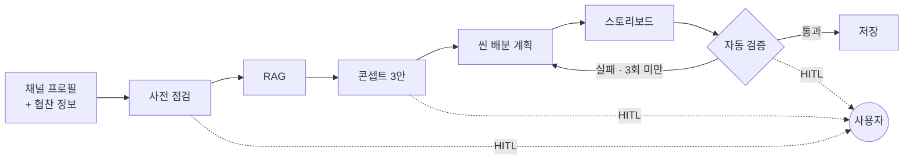

# 협찬 숏폼 기획 Agent

협찬 받은 인플루언서의 숏폼(60초 이하) 기획을 대신 짜 주는 Agent.

영상도 이미지도 만들지 않는다. 촬영은 인플루언서가 하고, 이미지는 다른 생성 AI가 그린다.
남는 문제는 그 앞단 — **내 채널 톤을 지키면서, 광고주 포인트를 다 넣고, 광고 규정에 걸리지 않는** 기획이다.
셋은 동등하다. 톤이 깨지면 구독자가 떠나고, 포인트가 빠지면 재협찬이 끊기고, 표시를 빠뜨리면 제재를 받는다.



## 누가 쓰나

> **지은 (29)**, 팔로워 3만의 자취 살림 채널. 친구한테 말하듯 반말로 "자취 5년 차 현실 꿀팁"을 푼다.
> 광고주 문구를 그대로 읽으면 댓글에 "광고네ㅋ"가 달린다. 기획에 건당 반나절, 광고 표시 규정은 "#광고 붙이면 되나?" 수준.

쇼츠·릴스 공통(9:16). 카테고리는 생활용품 · 전자·액세서리 · 일반식품 · 화장품 4종.
건강기능식품·의약품·의료기기는 법이 따로라 입력 단계에서 거절한다.

## 들어있는 것 (예정)

| | 하는 일 |
|---|---|
| `app/graph.py` | 상태 그래프. 사전 점검 → 콘셉트 → 계획 → 생성 → 검증 → 수정 루프 |
| `app/checks/` | 코드 규칙 검증 (금지 표현, 광고 표시, 길이, 노출 비율, 말투 비율) |
| `mcp_server/` | 광고 규정 검사기. Agent가 뜰 때 stdio로 같이 뜬다 |
| `knowledge/` | RAG 문서(공정위 추천·보증 심사지침, 숏폼 노하우)와 `rules.json`(금지·허용 표현) |
| `eval/` | 평가셋 20세트, 가상 채널 4개, 기준선, 채점기 |
| `examples/` | 데모 입력 3종 |
| `app/web.py` | 웹 화면(Streamlit). 입력 폼, 상품 설명 붙여넣기, HITL 3곳을 버튼으로 |

필요한 것: Python 3.11+, AWS Bedrock 액세스 키(`AWS_ACCESS_KEY_ID`, `AWS_SECRET_ACCESS_KEY`). 선택: `LANGSMITH_API_KEY`(Trace), `TAVILY_API_KEY`(웹 리서치).

```
pip install -r requirements.txt
python -m app.main examples/normal.json     # 대화형 HITL로 기획 1건
python -m eval.run_eval                     # 20세트 × (Agent, 기준선) 채점
python -m streamlit run app/web.py          # 웹 화면 (http://localhost:8501)
```

## 입력

채널 프로필 한 장 + 협찬 정보 한 장. 프로필은 한 번 쓰면 `channels/`에 저장해 재사용한다.

| 채널 프로필 | 예 (자취 살림) |
|---|---|
| `concept` | 자취 5년 차의 돈 안 드는 현실 살림 꿀팁 |
| `speech_style` | 반말 |
| `tone_keywords` | 솔직함, 현실적, 가벼운 자조 개그 |
| `signature_opening` / `ending` | "자취 5년 차 꿀팁 들어간다" / "다음 꿀팁에서 보자" |
| `representative_format` | 문제 상황 → 꿀팁 → 비용 비교 |
| `avoid` | 과소비 조장, "무조건 사세요" |

협찬 정보는 `product_name`, `category`, `promo_points[]`, `length_sec`(15/30/45/60), `product_desc`.
MVP엔 웹 리서치가 없어서 `product_desc`가 사실상 필수다.

입력 방법은 두 가지다.
- **파일**: `examples/*.json`처럼 채널 ID와 협찬 정보를 적어 `python -m app.main`에 넘긴다.
- **웹 화면**: 채널은 가상 채널 중에서 고르거나 화면에서 직접 입력한다. 협찬 정보는 칸에 직접 쓰거나,
  쇼핑몰 상세페이지 글을 붙여 넣으면 생성 모델이 제품명·카테고리·`product_desc`·추천 `promo_points`를 채운다.
  포인트마다 원문 근거 문장을 인용하게 하고, 그 인용이 붙여 넣은 글에 실제로 있는지 코드로 확인해 없는 포인트는 뺀다.
  카테고리가 목록에 없으면 비워 두고 사람이 고른다. 결과는 초안이고 사람이 확인·수정한 뒤 시작한다.
  쇼핑몰 링크 자동 수집은 하지 않는다(쿠팡 등은 봇 접근 차단·약관상 자동 수집 금지, 상세페이지 대부분이 이미지).

## 출력

`outputs/{시각}_{제품명}/` 아래 세 파일.

- `기획안.md` — 기획안 요약 · 스토리보드 표 · 체크 리포트 · 업로드 패키지(제목/설명란/해시태그/광고 표시)
- `storyboard.json` — 스타일 시트 + 씬별 데이터 + **영문 이미지 프롬프트**. 이미지 생성 AI에 그대로 넣는다
- `check_report.json` — 항목별 pass/fail과 근거

씬은 정수 초, 합은 목표 길이와 같다. 첫 씬(훅)은 3초 이하에 제품이 나오지 않는다.
대사·자막은 한국어(채널 말투), 이미지 프롬프트만 영어.

## 사전 점검

광고주 포인트를 그대로 믿지 않는다. 생성 전에 걸러서 사용자에게 묻는다.

| 유형 | 예 | 제안 |
|---|---|---|
| 분량 초과 · 개수 | 15초에 포인트 7개 | 상위 N개만 영상에, 나머지는 설명란으로 (15/30/45/60초 → 2/3/4/5개) |
| 분량 초과 · 길이 | "앱 설정 7단계 전부 보여 주기" | 핵심 1~2단계만 영상, 전체는 설명란 |
| 분량 초과 · 비율 | "제품 장면 70% 이상" | 노출 30% 규칙 우선 |
| 모순 | "가장 저렴" + "프리미엄 최고급" | 한쪽만 |
| 채널 콘셉트 충돌 | 잔소리 큰언니 채널에 "칭찬만, 단점 금지" | 톤은 살리고 단점 대신 사용 팁으로 |
| 과장 표현 | "피부가 새로 태어나요" | 완화 표현 |

사용자 답은 제안대로 · 원래 포인트 그대로 · 중단, 그리고 웹 화면에서는 **직접 고치기**(포인트 문장을 고치거나 영상 ↔ 설명란으로 옮기기)가 있다.
직접 고쳐도 영상 포인트가 길이별 상한을 넘으면 코드가 뒤쪽을 설명란으로 옮긴다.
문제가 없으면 파일 실행에서는 묻지 않고 넘어가지만, 웹 화면에서는 포인트 구분을 항상 보여 주고 확인받는다.

## 콘셉트와 계획

콘셉트는 3안. 셋 다 채널 말투를 지키고, 훅 유형이 서로 다르다.
1안은 채널 대표 포맷에 제품만 끼워 넣고, 2·3안은 훅을 바꾼다. 큰언니 뷰티 × 선크림이면:

1. "너 선크림 이렇게 바르면 안 돼" — 평소 잔소리 리뷰 그대로
2. "아직도 선크림 안 발라?" — 질문형
3. 바르기 전후 비교 — 비포·애프터형

고른 안으로 바로 쓰지 않고 **씬 배분 계획**부터 세운다 — 어느 포인트를 몇 번째 씬에 몇 초, 시그니처 멘트는 어디, 무엇을 설명란으로.
검증에 실패하면 원고가 아니라 계획부터 다시 고친다. 최대 3회, 그래도 실패하면 미통과 표시를 단 채 최종 승인으로 넘긴다.

## 검증 — 코드로 판정한다

전문가 피드백이 없으니 정답을 코드로 확인할 수 있어야 한다.
셀 수 있는 건 `rules.json`과 코드로, 의미 판단이 필요한 건 채점 AI에 맡기되 **근거 문장 인용을 받아 그 문장이 원고에 실제로 있는지 코드가 확인**한다.

| | 항목 | 통과 기준 |
|---|---|---|
| A1 | 말투 일치 | 프로필 말투 문장 비율 ≥ 90%. "꿀팁 대방출" 같은 어미 없는 문구는 중립, 계산 제외 |
| A2 | 시그니처 멘트 | 오프닝·엔딩 포함 (의미가 같으면 인정) |
| A3 | `avoid` 위반 | 0건 |
| A4 | 콘셉트 적합도 | 채점 AI 4/5 이상 |
| B1 | 포인트 반영 | 100%. 설명란으로 보낸 포인트는 설명란에 있으면 인정 |
| C1 | 광고 표시 | 제목 또는 설명란 첫 줄에 `[광고]`·`#광고`. `sponsored`·`ad`·`#내돈내산` 단독은 실패 |
| C2 | 금지 표현 | 0건 |
| C3 | 제품 노출 | 노출 씬 길이 합 ÷ 전체 ≤ 30% |
| C4 | 첫 씬 | 제품 노출 없음 |
| C5 | 길이 | 씬 합 = 목표 길이 |
| T1 | 함정 탐지 | (함정 케이스만) 사전 점검이 맞는 유형을 잡고, 결과가 제안대로 처리됨 |

영상 안 '유료광고 포함' 표시는 기획안에 권장만 하고 채점하지 않는다.

**Agent는 채점기를 보지 못한다.** 수정 루프 안의 검사는 코드 규칙과 생성 모델의 자체 점검뿐이고,
최종 채점은 별도 상위 모델(temperature 0)이 한다. 시험지를 보고 푼 점수가 되지 않게.

## 평가

20세트 × (Agent, 기준선). 기준선은 같은 생성 모델에 같은 채널 프로필·협찬 정보를 주고 프롬프트 한 번으로 같은 JSON을 뽑게 한 것이다.
점수 차이가 정보량이 아니라 구조에서 나왔다고 말하려면 입력이 같아야 한다.

| 구성 | 수 |
|---|---|
| 일반 (같은 제품 × 다른 채널 쌍 2쌍 이상 포함) | 13 |
| 분량 초과 (개수 · 길이 · 비율) | 3 |
| 모순 | 2 |
| 채널 콘셉트 충돌 | 2 |

가상 채널 4개: 자취 살림(반말) · 직장인 출근룩(존댓말) · 맞벌이 주부 살림(존댓말) · 잔소리 큰언니 뷰티(반말).
실존 계정을 참고만 하고 각색했다. 실명·대본 원문은 레포에 없다.

케이스 점수는 해당 항목 pass/fail 평균, 그룹(A 톤 · B 포인트 · C 규정)별로도 따로 낸다.
측정 때는 평가셋에 적어 둔 HITL 응답을 자동으로 넣어 재현성을 맞춘다. 데모는 100% 대화형.

| | Agent | 기준선 |
|---|---|---|
| 전체 | 0.946 | 0.784 |
| A 채널 톤 | 0.938 | 0.938 |
| B 포인트 반영 | 1.000 | 1.000 |
| C 규정·구성 | 0.950 | 0.660 |
| T1 함정 탐지 | 0.857 | 0.143 |

(T21 최종 평가, 생성 Claude Haiku 4.5 · 채점 Claude Sonnet 4.6. 상세: [docs/results/eval_summary.md](docs/results/eval_summary.md))

성공 기준: **Agent ≥ 0.9, 그리고 기준선보다 높음.** 같은 제품 × 다른 채널 결과는 훅·첫 대사·제목을 나란히 놓은 비교표로 따로 보여 준다(점수 외).

## MVP

P0 → P1 → P2 순서로 만든다. 모자라면 P2 → P1 순으로 버리고 P0는 건드리지 않는다.

| | 범위 |
|---|---|
| **P0** | 예시 파일 입력 · 그래프 + HITL 3곳 · 사전 점검 · RAG(검색 도구) · 콘셉트 3안 · 계획 · 생성 · 코드 검증 + 수정 루프 · 저장 · MCP 검사기(금지 표현 1개) · 평가 20세트 + 기준선 + 채점기 |
| P1 | 재시도·호출 상한·금지 표현 가드 미들웨어 · LangSmith Trace · MCP에 광고 표시 검사 추가 |
| P2 | Tavily 웹 리서치 + 캐시 · 대화형 입력 · 노하우 문서 확장 · LangSmith 공유 링크 · 웹 화면(Streamlit) + 상품 설명 붙여넣기 + 포인트 직접 고치기 |

작업 순서와 단위는 [TASKS.md](TASKS.md)를 따른다.

## 돈은 어떻게 버나

인플루언서 본인이 낸다. 월 2건 무료, 그 이상은 월 구독(무제한 + 채널 프로필 여러 개).
협찬 1건 단가가 구독료보다 훨씬 커서, 재협찬 한 번이나 기획 반나절만 아껴도 회수된다.
다음 고객은 MCN(소속 크리에이터 팀 요금제)과 광고주(브리프를 여러 인플루언서에게 배포). MVP엔 결제도 회원도 없다.

## 범위 밖

실제 이미지·영상 생성 · 채널 URL 자동 분석 · 쇼핑몰 링크 자동 수집 · 상세페이지 이미지 글자 읽기 · 플랫폼별 최적화 · 회원·결제.

웹 화면은 처음엔 범위 밖이었으나 P2로 넣었다([결정 로그](docs/decisions.md) Q49). 실험용 로컬 화면이며 배포·로그인은 없다.

## 아직 안 정한 것

- **과장 표현 함정** — 적절한 예시가 없어 평가셋에서 뺐다. 사전 점검 기능은 남아 있다
- **구독료** — 월 1~2만 원대 가설, 근거 없음
- **P0가 제때 안 끝나면** — 콘셉트를 "3안 + 선택"에서 "1안 + 승인"으로 줄이는 게 1순위 후보
- **모델명** — 생성은 경량, 채점은 한 단계 위. 정확한 이름은 키로 쓸 수 있는 목록을 보고 정한다
- **`product_visible` 신뢰도** — Agent 자체 표시를 채점 AI가 재확인하지만, 화면 설명만으로 판단이 맞는지는 측정해 봐야 안다

- [결정 로그](docs/decisions.md) — 기획 세션에서 합의한 Q1~Q46
