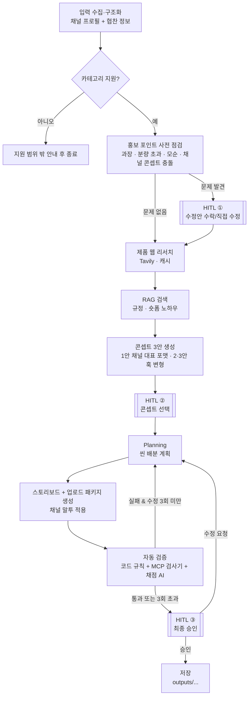

# 협찬 숏폼 기획 Agent — 서비스 기획서 (service.md)

> AX 교육 미니프로젝트 · 개발 2026-11-18(수) ~ 11-19(목) · 제출 2026-11-20(금) 15:00
> 제출물: GitHub Public Repository + ZIP

---

## 1. 서비스 개요

| 항목 | 내용 |
|---|---|
| 서비스명 | 협찬 숏폼 기획 Agent (가칭) |
| 한 줄 소개 | 협찬 제품과 광고주의 홍보 포인트를 **내 채널의 톤앤매너와 콘셉트에 맞게** 녹여서, 광고 규정을 지키는 60초 이하 숏폼 기획안·스토리보드·업로드 패키지를 만들어 주는 AI Agent |
| 사용자 | 자기 채널 색깔이 분명한 개인 인플루언서가 협찬을 받았을 때 |
| 대상 플랫폼 | YouTube Shorts · Instagram Reels 공통 (9:16 세로, 60초 이하) |

### 1.1 해결하려는 문제 (세 가지 모두 동등한 핵심)
| # | 문제 | 왜 어려운가 |
|---|---|---|
| A | **채널 톤앤매너·콘셉트 유지** | 협찬 영상이 평소 말투와 포맷에서 벗어나면 "광고 티"가 나서 구독자가 이탈하고 채널 정체성이 흐려진다 |
| B | **광고주 홍보 포인트 반영** | 광고주가 요구한 포인트를 빠짐없이 넣어야 하지만 짧은 영상에 다 담기 어렵다. 포인트가 너무 많거나, 서로 모순되거나, 채널 콘셉트와 충돌하기도 한다 |
| C | **광고 규정 준수** | 공정위 「추천·보증 등에 관한 표시·광고 심사지침」의 광고 표시 의무와 과장·금지 표현을 잘 몰라 실수하기 쉽다 |

Agent는 이 세 가지를 **동시에** 만족하는 기획안을 만들고, 충돌이 생기면 사용자에게 묻는다(HITL).

### 1.2 페르소나 (README에도 사용)
> **지은 (29세)**, 팔로워 3만 명의 **자취 살림 채널** 운영자. 친구한테 말하듯 **반말**로 "자취 5년 차 현실 꿀팁"을 알려 주는 게 채널 콘셉트다.
> 한 달에 2~3건 협찬을 받는다. 그런데 광고주가 보내 준 홍보 문구를 그대로 읽으면 평소 말투와 너무 달라서 댓글에 "광고네ㅋ"가 달린다.
> 기획에 건당 반나절이 걸리고, 광고 표시 규정은 "대충 #광고 붙이면 되나?" 정도로만 안다.

### 1.3 비즈니스 모델 (참고 · MVP에서는 구현하지 않음)
| 항목 | 내용 |
|---|---|
| 고객 (돈을 내는 사람) | **인플루언서 본인 (B2C)**. 지금의 페르소나와 같다 |
| 과금 방식 | **무료 월 2건 + 월 구독** (구독 시 무제한 생성, 채널 프로필 여러 개 저장). 구독료는 월 1~2만 원대로 가정하며, 검증이 필요한 가설이다 |
| 돈을 낼 이유 | ① **시간 절감**: 건당 반나절 걸리던 기획을 짧은 시간 안에 초안으로 받는다 ② **리스크 감소**: 광고 표시 누락과 금지 표현으로 인한 제재·논란을 예방한다 ③ **재협찬**: 홍보 포인트를 빠짐없이 반영하면서 채널 톤을 지켜, 광고주 만족과 구독자 반응을 함께 챙긴다 |
| 왜 낼 만한가 | 협찬 1건 단가가 구독료보다 훨씬 크므로, 재협찬 1건이나 기획 시간 몇 시간만 아껴도 구독료를 회수한다 |
| 확장 대상 | **MCN·에이전시**: 소속 크리에이터 여러 명의 채널 프로필을 관리하는 팀 요금제 / **광고주**: 캠페인 브리프를 여러 인플루언서에게 나눠 주고, 반영 결과를 모아 보는 기능 |
| MVP 범위 | 이번 프로젝트에서는 **문서로만 정리**한다. 결제, 회원가입, 무료 사용 횟수 제한은 구현하지 않는다 |

---

## 2. 범위

### 2.1 포함 (In scope)
- 지원 카테고리 4종: **생활용품 / 전자기기·액세서리 / 일반 식품·음료 / 화장품**
- 영상 길이: **15 / 30 / 45 / 60초 중 선택**
- **채널 프로필 양식** 입력 (한 번 작성하면 파일로 저장해 재사용)
- 산출물 4종: ① 기획안 요약 ② 스토리보드 표 ③ 체크 리포트 ④ 업로드 패키지
- 이미지 생성 AI용 **스타일 시트 + 씬별 영문 이미지 프롬프트** (Markdown 표 + JSON)
- 대화형 HITL (터미널)

### 2.2 MVP 정의 — 구현 가능 시간: 11/19(목) 09:00~18:00 (9시간)
작업 가능 시간은 **목 09~18시(구현)**, **금 09~15시(측정·검토·제출)**뿐이다.

MVP는 **"예시 입력 파일 하나로 실행하면, HITL 3곳을 거쳐 4종 산출물이 저장되고, 평가 20세트에서 Agent와 기준선의 점수를 비교할 수 있는 상태"**다. 시간이 부족하면 P2 → P1 순서로 포기하고, P0는 줄이지 않는다.

| 우선순위 | 범위 | 마감 |
|---|---|---|
| **P0 (MVP)** | ① 예시 파일 입력(3.3 b) + 채널 프로필 JSON 파일 ② LangGraph 흐름 + HITL 3곳 ③ 사전 점검 · RAG(📕 + 📗 최소 3개, **RAG 검색 도구로 Tool Calling**) · 콘셉트 3안 · Planning · 생성 ④ 코드 규칙 검증 + 수정 루프(최대 3회) ⑤ 산출 파일 3종 저장 ⑥ **MCP 검사기 최소 형태**(금지 표현 검사 도구 1개, 교육 요건이라 P0) ⑦ 평가셋 20세트 + 기준선 + 채점기 + 결과표 | 목 17:00 (평가 1차 실행까지) |
| **P1** | ① Middleware (LangChain 기본 제공 재시도·호출 횟수 제한 + 금지 표현 가드) ② LangSmith Trace (환경 변수만 설정) ③ MCP 검사기에 광고 표시 문구 검사 추가 | 목 18:00 → 못 하면 금 12~14시 |
| **P2** | ① Tavily 웹 리서치 + 캐시 ② 대화형 입력(3.3 a)과 채널 프로필 대화형 작성·저장 ③ 📗 문서 확장(5~8개) ④ LangSmith 공개 링크·스크린샷 ⑤ README의 "같은 제품 × 다른 채널" 비교표 다듬기 | 금 12~14시 여유 시 |

- P2의 대화형 입력이 빠져도 평가자 데모는 예시 파일 방식(README 안내)으로 진행되므로 문제없다. **HITL 응답은 P0부터 대화형**이다.
- Tavily가 P2라서, MVP에서는 웹 리서치 노드 대신 입력의 `product_desc`(제품 설명)를 사용한다.

### 2.3 제외 (Out of scope)
- **건강기능식품 · 의약품 · 의료기기**: 입력 단계에서 "지원 범위 밖"으로 안내하고 종료
- 채널 URL로 기존 영상을 자동 수집·분석하는 기능 (YouTube·Instagram API)
- 실제 이미지·영상 생성
- 플랫폼별 개별 최적화 (쇼츠 전용, 릴스 전용 등)
- 웹 UI (시간이 남으면 추가 검토)

---

## 3. 입력 명세

### 3.1 채널 프로필 (양식 직접 작성)
| 필드 | 필수 | 설명 | 예시 (자취 살림 채널) |
|---|---|---|---|
| `channel_name` | O | 채널 이름 | 자취오년차 |
| `concept` | O | 채널 콘셉트 한두 문장 | 자취 5년 차가 알려 주는 돈 안 드는 현실 살림 꿀팁 |
| `target_audience` | O | 주 시청자 | 20~30대 1인 가구 |
| `speech_style` | O | `반말` / `존댓말` | 반말 |
| `tone_keywords` | O | 톤을 나타내는 단어 3~5개 | 솔직함, 현실적, 가벼운 자조 개그 |
| `signature_opening` | X | 늘 쓰는 오프닝 멘트 | "자취 5년 차 꿀팁 들어간다" |
| `signature_ending` | X | 늘 쓰는 엔딩 멘트 | "다음 꿀팁에서 보자" |
| `representative_format` | O | 채널 대표 영상 형식 | 문제 상황 → 꿀팁 → 비용 비교 |
| `avoid` | O | 채널에서 피하는 소재·표현 목록 | 과소비 조장, "무조건 사세요" 같은 강매 표현 |

- 대화형 실행 시 위 항목을 순서대로 묻고, `channels/{채널명}.json`으로 저장해 다음부터 재사용한다.

### 3.2 협찬 정보
| 필드 | 필수 | 설명 |
|---|---|---|
| `product_name` | O | 협찬 제품명 |
| `category` | O | `생활용품` / `전자·액세서리` / `일반식품` / `화장품` (그 밖의 값이면 거절) |
| `promo_points` | O | 광고주가 기대하는 홍보 포인트 목록. 각 항목은 `id`, `text`, `priority`(선택) |
| `length_sec` | O | `15` / `30` / `45` / `60` |
| `product_desc` | △ | 제품 설명 (사용자가 아는 정보). **MVP에서는 웹 리서치 대신 이 값을 쓰므로 사실상 필수** |

### 3.3 입력 방식
- **(a) 대화형**: 실행하면 터미널이 채널 프로필(저장된 것이 있으면 선택) → 제품명 → 카테고리 → 홍보 포인트(한 줄에 하나) → 영상 길이 순서로 질문
- **(b) 파일 지정**: `examples/*.json` 예시 입력 파일(채널 프로필 + 협찬 정보)을 인자로 지정해 바로 실행. README 데모는 이 방식으로 안내

---

## 4. 출력 명세

### 4.1 산출물 4종
| # | 산출물 | 내용 |
|---|---|---|
| ① | 기획안 요약 | 선택된 콘셉트, 훅 유형, **채널 톤을 어떻게 유지했는지**, 타깃 시청자, 핵심 메시지, **촬영 시 첫 화면에 '유료광고 포함' 표시 권장 안내** |
| ② | 스토리보드 표 | 씬 / 길이(초) / 화면 / 대사 / 자막 / 반영 홍보 포인트 / 제품 노출 여부 / 영문 이미지 프롬프트 |
| ③ | 체크 리포트 | 자동 검증 항목별 통과·실패와 근거, 수정 횟수, 미통과 항목 |
| ④ | 업로드 패키지 | 제목 / 설명란 / 해시태그 / 광고 표시 문구 (채널 말투 적용) |

### 4.2 저장 형식
실행할 때마다 `outputs/{YYYYMMDD_HHMMSS}_{제품명}/` 폴더를 만들고 아래 세 파일을 저장한다.

| 파일 | 용도 |
|---|---|
| `기획안.md` | 사람이 읽는 문서. ①~④를 한 문서에 담음 |
| `storyboard.json` | 이미지 생성 AI 입력용. 스타일 시트 + 씬별 데이터 + 영문 프롬프트 |
| `check_report.json` | 채점 스크립트 입력용. 항목별 pass/fail + 근거 |

### 4.3 `storyboard.json` 구조 (초안)
```json
{
  "channel": "자취오년차",
  "style_sheet": {
    "aspect_ratio": "9:16",
    "visual_style": "bright, natural daylight, handheld vlog look",
    "color_palette": ["..."],
    "character": "Korean woman in late 20s, casual home wear, small studio apartment",
    "negative": "no text, no logo distortion"
  },
  "scenes": [
    {
      "scene_no": 1,
      "duration_sec": 3,
      "visual": "화면 설명 (한국어)",
      "dialogue": "대사",
      "caption": "자막",
      "promo_point_ids": [],
      "product_visible": false,
      "image_prompt_en": "..."
    }
  ],
  "moved_to_description": ["P5", "P6"]
}
```

### 4.4 언어
- 기획안, 대사, 자막, 업로드 패키지: **한국어** (채널 프로필의 말투 적용)
- 스타일 시트, 씬별 이미지 프롬프트: **영어**

---

## 5. Agent 흐름 (LangGraph)



### 5.1 노드 설명
| 노드 | 역할 |
|---|---|
| 입력 구조화 | 채널 프로필과 협찬 정보를 표준 스키마로 변환하고, 카테고리 지원 여부 확인 |
| 사전 점검 | 홍보 포인트의 **과장 표현 / 분량 초과 / 모순 / 채널 콘셉트 충돌**을 탐지하고 수정안 제시. 결과는 `precheck` 로그로 남김 (함정 탐지 채점에 사용) |
| HITL ① | 문제가 있을 때만 발생. 사용자가 수정안을 수락하거나 직접 고름 |
| 웹 리서치 (P2) | Tavily로 제품 정보와 주 사용층 검색. 결과는 `data/research_cache/`에 캐시. **MVP에서는 이 노드를 건너뛰고 `product_desc`를 사용** |
| RAG | 광고 규정과 숏폼 노하우 문서에서 관련 내용 검색 |
| 콘셉트 3안 | 세 안 모두 채널 말투·톤 유지. **1안 = 채널 대표 포맷에 제품을 자연스럽게 끼워 넣기**, **2·3안 = 훅 유형을 바꾼 변형**. 세 안의 훅 유형은 서로 다름 |
| HITL ② | 사용자가 콘셉트를 선택 |
| Planning | **씬 배분 계획**: 어떤 포인트를 몇 번째 씬에 몇 초 넣을지, 시그니처 멘트를 어디에 넣을지, 무엇을 설명란으로 보낼지 표로 계획 |
| 생성 | 계획에 따라 스토리보드와 업로드 패키지를 채널 말투로 작성 |
| 자동 검증 | 8장의 검증 항목 실행. 실패하면 실패 사유를 계획 단계로 되돌려 수정 (**최대 3회**) |
| HITL ③ | 최종 승인 / 수정 요청(코멘트) / 중단. 사용자 수정 요청은 자동 수정 3회와 별도로 센다. 자동 수정 3회 후에도 실패하면 **미통과 항목을 표시한 상태로** 승인 단계에 올림 |

**콘셉트 3안 예시** (큰언니 뷰티 채널 × 선크림):
- 1안 (대표 포맷): 평소처럼 "너 선크림 이렇게 바르면 안 돼" 잔소리 리뷰 형식에 제품만 넣기
- 2안 (질문형 훅): "아직도 선크림 안 발라?"로 시작
- 3안 (비포·애프터형 훅): 바르기 전후 비교로 시작

### 5.2 사전 점검 규칙
| 유형 | 탐지 기준 | 제안 동작 |
|---|---|---|
| 과장 표현 | 금지 표현 사전과 일치하거나 LLM이 과장으로 판단 | 완화 표현 제안 |
| 분량 초과 ① 개수 | 포인트 수 > 길이별 상한 N (15초=2, 30초=3, 45초=4, 60초=5) | 우선순위 상위 N개만 영상에 넣고, 나머지는 설명란으로 이동 |
| 분량 초과 ② 길이 | 한 포인트가 영상 길이 안에 담을 수 없는 분량을 요구 (예: 앱 설정 7단계 전부 시연) | 핵심 1~2단계만 영상에 넣고, 전체 내용은 설명란에 안내 |
| 분량 초과 ③ 비율 | 제품 노출 비율 요구가 규칙(≤ 30%)과 충돌 | 지적하고 규칙(30%)을 우선 |
| 모순 | 두 포인트가 동시에 성립할 수 없음 (예: "가장 저렴" + "프리미엄 최고급") | 지적하고 한쪽만 반영 |
| **채널 콘셉트 충돌** | 포인트가 채널 프로필의 `avoid` 또는 `concept`와 충돌 (예: 큰언니 잔소리 채널에 "단점 언급 금지, 칭찬만") | 지적하고, 채널 톤에 맞게 바꾼 표현 제안 (예: 잔소리 톤은 유지하되 단점 대신 "이렇게 써야 제대로 써" 사용 팁으로 전환) |

---

## 6. 교육 기술 요소 매핑

| 기술 | 적용 위치 |
|---|---|
| Python | 전체 구현 |
| LangChain | LLM 호출, 프롬프트, 구조화 출력, Retriever |
| LangGraph | 5장의 상태 그래프, 수정 루프, `interrupt` 기반 HITL |
| RAG | 광고 규정 + 숏폼 노하우 문서 검색 (로컬 Chroma 또는 FAISS) |
| Tool Calling | RAG 검색 도구 (P0), Tavily 웹 검색 도구 (P2) |
| MCP | **자체 MCP 서버 "광고 규정 검사기"**: 금지 표현 검사, 광고 표시 문구 검사. Agent 실행 시 자동으로 함께 기동 (stdio) |
| Middleware | ① 금지 표현 가드 (생성 직후 즉시 검사·경고) ② 실행 1회당 LLM 호출 횟수·비용 상한 ③ 일시 오류 자동 재시도 |
| HITL | 사전 점검 / 콘셉트 선택 / 최종 승인, 3곳 (대화형) |
| Planning | 씬 배분 계획 노드. 수정 루프에서도 계획부터 다시 수정 |
| Trace | LangSmith (키가 없으면 로컬 로그로 대체) |
| Evaluation | 평가셋 20세트 × (Agent, 기준선) 자동 채점, LLM-as-judge |

### 6.1 모델 배정
| 용도 | 모델 | 비고 |
|---|---|---|
| 생성 (Agent, 기준선 공통) | OpenAI 경량 모델 (예: `gpt-4o-mini` 계열) | 공정한 비교를 위해 같은 모델 사용 |
| 채점 (LLM-as-judge) | 한 단계 위 모델 (예: `gpt-4o` 계열), temperature 0 | |

정확한 모델명은 개발을 시작할 때 사용 가능한 모델 목록을 확인해서 정하고, 설정 파일 한 곳에서 바꿀 수 있게 한다.

---

## 7. 지식 자료 (RAG + 규칙 파일)

| 구분 | 내용 | 용도 | 작성 |
|---|---|---|---|
| 📕 공식 규정 | 공정위 「추천·보증 등에 관한 표시·광고 심사지침」 및 관련 해설 (공개 자료) | RAG (생성 품질) | 공개 자료 수집 |
| 📗 숏폼 노하우 | 훅 유형 정의, 60초 이하 구성 공식, 제품 노출 요령, **협찬을 채널 톤에 녹이는 법**, 카테고리별 주의 표현 등 짧은 문서 5~8개 | RAG (생성 품질) | AI 초안 작성 → 사용자 검토 |
| 📘 규칙 파일 (JSON) | 금지·과장 표현 사전, 광고 표시 허용 문구, 금지 문구 (영문·애매 표현) | **코드 검증** + MCP 검사기 | AI 초안 작성 → 사용자 검토 |

원칙: **RAG는 잘 쓰게 돕는 용도이고, 채점은 JSON 규칙과 코드로 결정론적으로 한다.** 채점 AI가 필요한 항목은 반드시 근거 인용을 받아 코드로 확인한다.

### 7.1 훅 유형 (📗에 정의, 콘셉트 3안에 서로 다르게 배정)
`문제 제기형` · `비포·애프터형` · `일상 상황극형` · `반전형` · `질문형`

---

## 8. 자동 검증 항목

### 8.0 Agent 내부 검사와 최종 채점의 분리 (공정성)
Agent가 채점기를 미리 보고 고치면 "시험 문제를 보고 푸는" 셈이 되어 기준선과의 점수 차이가 과장된다. 그래서 둘을 분리한다.

| 구분 | 누가 | 무엇으로 |
|---|---|---|
| **Agent 내부 검사** (수정 루프용) | Agent | 코드 규칙(📘, MCP 검사기, 길이·비율 계산) + **생성 모델**의 자체 점검 |
| **최종 채점** (평가용) | 채점 스크립트 | 같은 코드 규칙 + **별도 채점 모델**(LLM-as-judge). 채점 모델과 채점 프롬프트는 Agent가 호출하지 않음 |

이 분리 원칙은 README에도 밝힌다. 아래 표의 "판정 방식"은 **최종 채점** 기준이다.

### 8.1 그룹 A — 채널 톤앤매너 유지
| # | 항목 | 통과 기준 | 판정 방식 |
|---|---|---|---|
| A1 | 말투 일치 | 대사·자막 문장 중 프로필 말투(`반말`/`존댓말`)와 맞는 비율 ≥ 90%. "꿀팁 대방출", "비용 0원"처럼 어미가 없는 짧은 문구는 **중립**으로 분류해 계산에서 제외 | 채점 AI가 문장별로 반말/존댓말/중립 분류 → **비율 계산은 코드** |
| A2 | 시그니처 멘트 | 프로필에 시그니처 오프닝·엔딩이 있으면 대사에 포함 (의미가 같으면 인정) | 채점 AI가 판단하고 근거 문장 인용 → **인용문 존재 여부는 코드** 확인. 프로필에 없으면 해당 없음(통과) |
| A3 | 피하는 것 0건 | 프로필 `avoid`에 적힌 소재·표현이 대사·자막·업로드 패키지에 없음 | 채점 AI가 위반 문장 인용 → 인용문이 실제 있으면 실패 (코드 확인) |
| A4 | 콘셉트 적합도 | 채점 AI 점수 ≥ 4점 (1~5점) | 채점 AI가 점수와 근거 인용. 인용문 존재 여부는 코드 확인 |

### 8.2 그룹 B — 홍보 포인트 반영
| # | 항목 | 통과 기준 | 판정 방식 |
|---|---|---|---|
| B1 | 홍보 포인트 반영 | 영상에 넣기로 한 포인트는 모두 씬에 반영되고, 설명란으로 보낸 포인트는 설명란에 있음 (반영률 100%) | **채점 AI가 의미로 판단**하고 근거 문장을 그대로 인용. **인용문이 실제 대사·자막·설명란에 있는지 코드가 확인**. 인용이 없거나 지어낸 문장이면 실패 |

### 8.3 그룹 C — 광고 규정·영상 구성
| # | 항목 | 통과 기준 | 판정 방식 |
|---|---|---|---|
| C1 | 광고 표시 문구 | 업로드 패키지의 **제목 또는 설명란 첫 줄**에 `[광고]` 또는 `#광고` 등 허용된 한글 표시가 있음. `sponsored`, `ad`, `협찬인 듯`, `#내돈내산` 같은 영문·애매 표현만 단독으로 쓰면 실패 | 코드 (📘 + MCP 검사기) |
| C2 | 금지 표현 0건 | 대사, 자막, 업로드 패키지에 금지·과장 표현이 하나도 없음 | 코드 (📘 + MCP 검사기) |
| C3 | 제품 노출 비율 | (제품이 나오는 씬의 길이 합 ÷ 전체 길이) ≤ 30% | Agent가 표시한 `product_visible` 값을 **채점 AI가 화면 설명으로 재확인**. 둘이 다르면 채점 AI 판정을 따름. 계산은 코드 |
| C4 | 첫 씬 제품 노출 없음 | 1번 씬이 `product_visible = false` (훅은 3초 이하) | C3과 같음 |
| C5 | 길이 합계 | 씬 길이(정수, 초)의 합 = 목표 길이 | 코드 |

### 8.4 함정 케이스 전용
| # | 항목 | 통과 기준 | 판정 방식 |
|---|---|---|---|
| T1 | 함정 탐지 | 9.3 참고 | 코드 (precheck 로그 + 결과물) |

- 영상 안의 광고 표시(첫 화면 '유료광고 포함')는 **권장 안내만** 하고 채점하지 않는다.
- 콘셉트 3안의 훅 유형이 서로 다른지는 **Agent 전용 참고 지표**로 별도 표시하고 점수에는 넣지 않는다.

---

## 9. 평가 설계

### 9.1 가상 채널 프로필 4개
실존 인플루언서 계정 몇 개를 **참고만** 해서 말투·포맷·시그니처 멘트의 특징을 뽑고, **이름·대본 원문 없이 각색한 가상 채널**로 만든다. 저장소에는 가상 프로필만 넣는다.

| ID | 채널 | 말투 | 콘셉트 요약 |
|---|---|---|---|
| CH1 | 자취 살림 | 반말 | 자취 n년 차의 돈 안 드는 현실 살림 꿀팁 |
| CH2 | 직장인 출근룩 | 존댓말 | 바쁜 아침, 직장인 출근 코디·준비 루틴 |
| CH3 | 맞벌이 주부 살림 | 존댓말 | 시간 없는 맞벌이 가정의 효율 살림법 |
| CH4 | 잔소리 큰언니 뷰티 리뷰 | 반말 | T 스타일로 팩트 잔소리하며 뷰티 제품을 리뷰하는 큰언니 |

### 9.2 평가셋 (20세트)
| 구분 | 개수 | 설명 |
|---|---|---|
| 일반 | 13 | 4개 채널, 4개 카테고리, 4개 길이를 고르게 섞음. 이 중 **"같은 제품을 다른 두 채널에 넣는" 쌍을 2쌍 이상** 포함 (예: 같은 무선 청소기를 CH1과 CH3에) |
| 분량 초과 ① 개수 | 1 | 예: 15초 무선 이어폰, 포인트 7개 |
| 분량 초과 ② 길이 | 1 | 예: 로봇청소기 "앱 설정 7단계 전부 보여 주기" |
| 분량 초과 ③ 비율 | 1 | 예: "제품 사용 장면을 70% 이상으로" |
| 모순 | 2 | 예: "가장 저렴" + "프리미엄 최고급" |
| 채널 콘셉트 충돌 | 2 | 예: CH4(잔소리 큰언니)에 "단점 언급 금지, 칭찬만" / CH1(현실 살림)에 "여러 개 사두면 이득" |
| 과장 표현 | 0 (보류) | 적절한 예시가 떠오르면 추가. 사전 점검 기능 자체는 유지 |

파일 형식 (`eval/cases.jsonl`, 1줄 = 1케이스, 초안):
```json
{
  "id": "T01",
  "type": "overload_count",
  "channel_id": "CH2",
  "input": { "product_name": "...", "category": "전자·액세서리", "length_sec": 15,
             "promo_points": [{"id": "P1", "text": "...", "priority": 1}] },
  "expected": { "trap_type": "overload", "kept_point_ids": ["P1", "P2"],
                "moved_point_ids": ["P3", "P4", "P5", "P6", "P7"] },
  "hitl_answers": { "precheck": "accept", "concept": 1, "final": "approve" }
}
```
채널 프로필은 `eval/channels/CH1.json` ~ `CH4.json`에 두고 `channel_id`로 참조한다.

### 9.3 실행 방식
- **데모(평가자)**: 100% 대화형 HITL
- **측정(우리)**: 측정 스크립트가 케이스마다 `hitl_answers`를 HITL에 자동으로 넣어 20세트를 일괄 실행한다. 사용자 기능이 아니라 재현성을 위한 **테스트용 장치**다.
- **기준선**: "Agent 없이 ChatGPT에 한 번에 물어본 결과"에 해당한다. 같은 생성 모델에 **같은 채널 프로필과 협찬 정보**를 넣고, 단일 프롬프트 1회 호출로 같은 JSON 형식의 결과를 만든다. 사전 점검, RAG, 웹 리서치, 계획, 수정 루프는 없다. **같은 채점기**로 채점해서, 점수 차이가 채널 정보 유무가 아니라 Agent 구조에서 나온다는 것을 보인다.

### 9.4 함정 탐지 판정 (T1)
- **Agent**: ① precheck 로그에 올바른 함정 유형이 기록되고 ② 최종 결과가 정답 동작(5.2)을 따르면 통과
- **기준선**: 사전 점검 단계가 없으므로 **결과물이 문제를 그대로 따라 했는지**로 판정. 예: 15초에 포인트 7개를 모두 영상에 넣음, 모순된 두 포인트를 모두 넣음, 채널 `avoid`를 위반한 포인트를 그대로 넣음 → 실패

### 9.5 점수와 성공 기준
- 케이스 점수 = 해당 항목 pass(1)/fail(0)의 **평균** (일반 10개: A1~A4, B1, C1~C5 / 함정 11개: + T1)
- 그룹별 점수(A 채널 톤 / B 포인트 / C 규정·구성)도 따로 집계해서, 세 가지 핵심 문제를 각각 얼마나 해결했는지 보여 준다
- 전체 점수 = 20케이스 평균
- **성공 기준**: ① Agent 평균 ≥ 0.9 ② Agent > 기준선
- 결과물: `eval/results/` 아래 케이스별·그룹별 점수표(CSV/Markdown)와 Agent vs 기준선 비교표. 가능하면 LangSmith에도 업로드

### 9.6 "같은 제품 × 다른 채널" 비교표 (점수 외 정성 자료)
일반 케이스 안의 "같은 제품을 다른 두 채널에 넣은" 쌍에 대해, 두 결과의 **훅 유형 · 첫 대사 · 업로드 제목**을 나란히 놓은 비교표를 만들어 README에 싣는다. 점수에는 넣지 않고, "채널 맞춤"이 실제로 일어나는지 한눈에 보여 주는 용도다.

---

## 10. 실행 환경

| 항목 | 내용 |
|---|---|
| 언어·설치 | Python 3.11 이상, `pip install -r requirements.txt` |
| API 키 | `.env.example`(빈 양식)만 저장소에 올리고, 실제 키는 올리지 않음 |
| `OPENAI_API_KEY` | **필수** (평가자는 본인 키 사용) |
| `TAVILY_API_KEY` | 선택 (P2 기능). 없으면 README 데모 제품 3개는 **저장소에 넣어 둔 검색 결과 캐시**를 쓰고, 그 밖의 제품은 "웹 리서치 생략" 경고 후 입력 정보만으로 진행 |
| `LANGSMITH_API_KEY` | 선택. 없으면 Trace 기록만 끄고 로컬 로그로 대체 |
| MCP 서버 | Agent가 실행될 때 자동으로 함께 기동. 평가자가 따로 실행할 필요 없음 |

---

## 11. 저장소 구조 (예정)

```
mini-pjt/
├─ README.md               # 평가자용 안내 (12장)
├─ service.md              # 본 기획서
├─ requirements.txt
├─ .env.example
├─ app/
│  ├─ main.py              # 대화형 실행 진입점
│  ├─ graph.py             # LangGraph 정의
│  ├─ nodes/               # 각 노드
│  ├─ middleware.py
│  ├─ tools/               # Tavily, RAG 검색 도구
│  └─ checks/              # 자동 검증 (코드 규칙 + 채점 AI)
├─ mcp_server/             # 광고 규정 검사기 MCP 서버
├─ knowledge/
│  ├─ docs/                # 📕 📗 RAG 문서
│  └─ rules.json           # 📘 규칙 파일
├─ channels/               # 사용자가 저장한 채널 프로필
├─ data/research_cache/    # 웹 리서치 캐시
├─ examples/               # 데모 입력 3종 (채널 프로필 + 협찬 정보)
├─ eval/
│  ├─ channels/            # 가상 채널 프로필 CH1~CH4
│  ├─ cases.jsonl          # 평가셋 20세트
│  ├─ baseline.py          # 기준선 (단일 프롬프트)
│  ├─ run_eval.py          # 일괄 실행·채점
│  └─ results/
└─ outputs/                # 실행 결과
```

---

## 12. README.md (평가자용) 구성

1. 한 줄 소개 + 해결하는 문제 3가지 (채널 톤 / 홍보 포인트 / 광고 규정)
2. 페르소나 (1.2의 "지은")
3. 실행 방법: 설치 → `.env` 설정 → 실행 명령 한 줄
4. 데모 시나리오 3개 (`examples/` 입력 파일 사용): ① 정상 케이스 ② 분량 초과 함정 ③ 채널 콘셉트 충돌 함정
5. HITL 단계별 안내: "이런 질문이 나오면 이렇게 답해 보세요"
6. 출력물 보는 법: 산출물 4종과 파일 3종 설명
7. 평가 결과 요약: Agent vs 기준선 점수표 (전체 + 그룹 A/B/C), "같은 제품 × 다른 채널" 비교표(9.6), 내부 검사와 최종 채점을 분리했다는 공정성 설명(8.0)
8. Agent 구조도
9. Trace 보기: 우리가 실행한 데모 3개와 평가 결과의 **LangSmith 공개 공유 링크와 스크린샷** (평가자는 키 없이 확인 가능)

---

## 13. 일정

| 날짜·시간 | 작업 |
|---|---|
| 11/18 (수) | 기획 확정 (service.md). 작업자 사전 준비: OpenAI 키를 `.env`에 넣을 준비, LangSmith 무료 가입 |
| **11/19 (목) 09–10** | 데이터 준비: 가상 채널 4개, 평가셋 20세트, 규칙 JSON(📘), 지식 문서(📕 + 📗 3개). AI가 초안을 쓰고 사람은 검토만 |
| 10–13 | LangGraph 흐름 + HITL 3곳 + 사전 점검·RAG·콘셉트 3안·Planning·생성 (P0 ①~③) |
| 13–15 | 코드 검증 + 수정 루프, MCP 검사기 최소 형태, 파일 저장 (P0 ④~⑥) |
| 15–17 | 기준선 + 채점기, **평가 1차 실행 = MVP 완료** (P0 ⑦) |
| 17–18 | 버퍼 → 남으면 P1 |
| **11/20 (금) 09–12** | 평가 최종 실행, 결과표, README 작성 |
| 12–14 | P1 잔여분 → P2 여유분 |
| 14–15 | 최종 점검, 제출 (GitHub + ZIP) · **15:00 마감** |

---

## 14. 리스크와 추후 과제

| 리스크 / 과제 | 대응 |
|---|---|
| 채점 AI 판정이 흔들림 | temperature 0, 인용문을 코드로 검증, 상위 모델 사용 |
| 톤앤매너는 주관적이라 판정이 애매함 | 말투(반말/존댓말 비율), 시그니처 멘트, `avoid`처럼 **셀 수 있는 항목**으로 쪼개고, 주관적인 콘셉트 적합도(A4)는 근거 인용을 필수로 함 |
| 실존 인플루언서 참고에 따른 초상권·저작권 | 특징만 참고해 가상 채널로 각색. 실명·계정·대본 원문은 저장소에 넣지 않음 |
| `product_visible` 자체 표시 오류 | 채점 AI가 재확인하고, 다르면 채점 AI 판정을 따름 |
| 웹 검색 결과가 실행마다 다름 | 검색 결과 캐시로 재현성 확보 |
| 과장 표현 함정 케이스 없음 | 개발 후 적절한 예시가 생기면 평가셋에 추가 |
| 구현 시간 9시간뿐 | 2.2장 MVP 우선순위(P0/P1/P2)대로 진행하고, 부족하면 P2 → P1 순서로 포기. 목 17시에 P0가 안 끝나면 콘셉트 3안을 "3안 생성 + 선택"에서 "1안 생성 + 승인"으로 축소하는 것을 1순위 대안으로 검토 |
| Agent가 채점기에 맞춰 최적화 (점수 과장) | 내부 검사와 최종 채점 분리 (8.0) |
| 비용 폭주·무한 루프 | Middleware로 호출 상한 설정, 수정 루프 최대 3회 |

---

## 15. 결정 로그 (grilling 세션 합의 사항)

| # | 결정 |
|---|---|
| Q1 | 쇼츠·릴스 공통, 길이는 15/30/45/60초 선택, 씬 길이는 정수 초, 훅 ≤ 3초 |
| Q2 | OpenAI 사용 |
| Q3 | 터미널 실행, HITL은 LangGraph `interrupt` |
| Q4 | 지원 카테고리 4종, 건강기능식품·의약품·의료기기는 거절 |
| Q5 | 지식 자료 3종 (📕 공식 규정 / 📗 노하우 / 📘 규칙 JSON) |
| Q6 | 웹 검색은 Tavily(Tool Calling)와 캐시, MCP는 자체 광고 규정 검사기 |
| Q7 | 포인트 반영은 채점 AI의 의미 판단 + 인용문 코드 검증 |
| Q8 | 생성은 경량 모델(Agent·기준선 동일), 채점은 상위 모델 |
| Q9 | 분량 초과 함정 3종 (개수·길이·비율) + 모순 2. 과장 표현 함정은 보류 |
| Q10 | 광고 표시 채점은 업로드 패키지(제목 또는 설명란 첫 줄)만. 영문·애매 표현 단독 사용은 실패. 영상 내 표시는 권장 안내만 |
| Q11 | 제품 노출은 시간 기준 ≤ 30%, 자체 표시 + 채점 AI 재확인 |
| Q12 | 콘셉트 3안은 훅 유형이 서로 다름 (참고 지표) |
| Q13 | 평가자 데모는 대화형 HITL. 측정은 평가셋에 적힌 HITL 응답으로 일괄 실행 |
| Q14 | 3회 수정 후에도 실패하면 미통과 표시로 저장하고 감점 |
| Q15 | 일정: 11/18~19 개발, 11/20 오전 검토·제출 |
| Q16 | 평가자용 README 구성 (12장) |
| Q17 | 입력은 대화형 + 예시 파일 둘 다 지원 |
| Q18 | 산출 파일 3종 (`기획안.md`, `storyboard.json`, `check_report.json`) |
| Q19 | Trace는 LangSmith(가입 예정), 키가 없으면 로컬 로그 |
| Q20 | Middleware 3종 (금지 표현 가드, 호출·비용 상한, 재시도) |
| Q21 | Planning = 씬 배분 계획 |
| Q22 | 항목별 통과/실패 평균, 성공 = Agent ≥ 0.9이면서 기준선보다 높음 |
| Q23 | `.env.example`만 공개, OpenAI 키 필수, Tavily·LangSmith 키 선택 |
| Q24 | Tavily 키가 없으면 데모 3종은 캐시, 그 밖의 제품은 리서치 생략 |
| Q25 | LangSmith 공개 링크와 스크린샷을 README에 첨부 |
| Q26 | Python 3.11 이상 + pip, MCP 서버 자동 기동 |
| Q27 | 산출물은 한국어, 이미지 프롬프트와 스타일 시트는 영어 |
| Q29 | 핵심 문제는 **채널 톤앤매너 유지 · 홍보 포인트 반영 · 광고 규정 준수** 세 가지, 모두 동등 |
| Q30 | 채널 정보는 프로필 양식 직접 작성. 실존 계정은 참고만 하고 가상 채널로 각색 |
| Q31 | 톤 검증 4항목 추가: 말투 일치 ≥ 90%, 시그니처 멘트, `avoid` 0건, 콘셉트 적합도 ≥ 4점 |
| Q32 | 가상 채널 4개 (자취 살림 반말 / 직장인 출근룩 존댓말 / 맞벌이 주부 살림 존댓말 / 잔소리 큰언니 뷰티 반말), 같은 제품 × 다른 채널 쌍 포함 |
| Q33 | 함정에 "채널 콘셉트 충돌" 2개 추가 → 일반 13 + 분량 초과 3 + 모순 2 + 콘셉트 충돌 2 |
| Q34 | 콘셉트 3안: 1안 채널 대표 포맷, 2·3안 훅 변형, 모두 채널 말투 유지 |
| Q35 | 기준선에도 같은 채널 프로필 제공 |
| Q36 | 수익 모델의 고객은 인플루언서 본인(B2C). MCN·광고주는 확장 대상 |
| Q37 | 과금은 무료 월 2건 + 월 구독 |
| Q38 | 비즈니스 모델은 문서(1.3장)에만 정리하고 기능은 변경하지 않음 |
| Q39 | MVP를 정의하고 P0/P1/P2 우선순위를 둠 (2.2장). P0는 11/19 밤까지, MCP는 최소 형태로 P0 |
| Q40 | Agent 내부 검사(코드 + 생성 모델)와 최종 채점(별도 채점 모델)을 분리 |
| Q41 | 어미 없는 짧은 문구는 말투 "중립"으로 분류해 A1 계산에서 제외 |
| Q42 | "같은 제품 × 다른 채널" 비교표를 README에 싣고, 점수에는 넣지 않음 |
| Q43 | 작업 시간은 목 09–18시(구현), 금 09–15시(측정·제출). Tavily는 P2, Middleware는 P1로 이동 |
| Q44 | 시간 단위 일정 확정 (13장) |
| Q45 | 사전 준비는 OpenAI 키와 LangSmith 가입만 |
